# 拾听 Listenly

极简、离线的 Android 英语听力训练应用。精听和互动做题共用材料编号，切换模式时保留文章、播放位置与作答记录；界面适配现代竖屏、刘海屏和手势导航。

[下载 APK](https://github.com/AITopia-Shao/listenly-android/releases/latest) · [导入材料格式](docs/import-format.md) · [兼容性验证](docs/android-runtime-findings.md) · [MIT 许可证](LICENSE)

| 整套播放器 | 精听 · 双语 | 整篇答题 |
| --- | --- | --- |
| 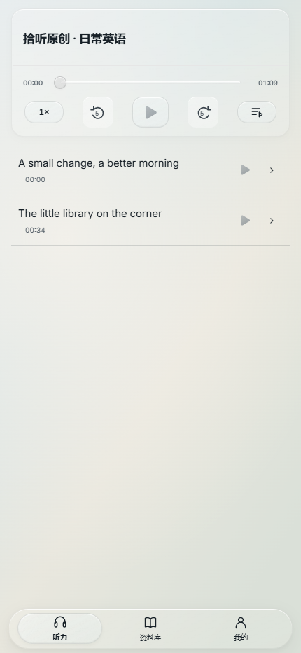 | 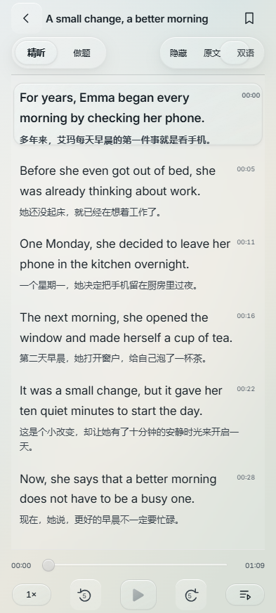 | 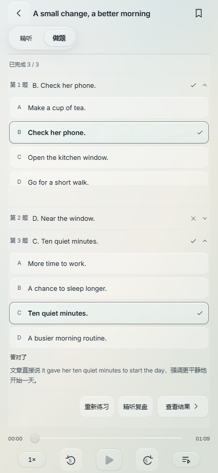 |

以上为 2.0.0 公开版本，使用项目原创 SVG 背景与原创英语示例，不包含第三方壁纸或六级真题。

## 2.0 的整套播放与考试合集

每套试卷使用一个完整录音，首页显示套卷信息与整套进度，点击篇章或正文分句按时间标记跳转。精听、做题和音频条共用一条时间轴；提交本篇后直接进入下一篇，最后提交后显示结果。资料库提供考试合集、套卷、篇章三级目录，预览与选择分开。

个人包换用 Ten Peaks 日夜壁纸。主题渐变改为合成外观动画，安卓在受支持屏幕上优先请求120Hz；真实GT7的120fps尚未测量，不将刷新率偏好描述为稳定帧率保证。[12轮性能对比](docs/suite-2-performance.md)保留改善和额外布局成本；[格式与材料迁移](docs/paper-timeline.md)说明旧记录保留、完整录音来源及无法定位的旧资料。

Android 8／11／16和浏览器四项[云端验证](https://github.com/AITopia-Shao/listenly-android/actions/runs/39268379302)全部通过，本地最终包另通过真实触控重播、整套定位和数据保留检查。[2.0.0公开安装包](https://github.com/AITopia-Shao/listenly-android/releases/tag/v2.0.0)只含原创示例；[完整验证范围](docs/suite-2-validation.md)保留历史失败、资料边界和真机限制。

## 1.0.13 的直接倍速与性能调整

倍速按钮直接按 `1 → 1.25 → 1.5 → 1.75 → 2 → 1` 循环，旧 `0.75` 记录迁移为 `1`，保留音频节点、源、进度与暂停／播放状态。主题改用浏览器原生颜色与壁纸透明度渐变；水平标签以固定双字重层交叉强调，配合局部同步和不变 DOM 去重，保留透镜运动。

重复布局和闲置工作已有减少，但最终整页压力对比的 P95 基本相同、总 Task 时间约增加 4.5%，不宣称所有机型的帧率提升。[倍速行为、限定基准与验证范围](docs/speed-and-performance.md)提供具体口径。

Android 8／11／16 和浏览器的四个[云端任务](https://github.com/AITopia-Shao/listenly-android/actions/runs/39095391360)全部通过，产物已按最终应用代码核验；[1.0.13 安装包](https://github.com/AITopia-Shao/listenly-android/releases/tag/v1.0.13)仅含原创示例。realme GT7 本轮尚未直接复测。

## 1.0.12 的壁纸与移动透镜

首页、资料库、个人页、正文、做题与结果页共享固定背景，日夜切换连续交叉渐变。公开 APK 使用原创 SVG 渐变；本地个人构建可使用指定的 Ten Peaks 日夜壁纸，第三方图片不随开源仓库或公开安装包分发。

普通控件、提交按钮与播放图形采用半透明材质。导航、分段切换、材料选择与分句高亮共用有轻微滞后形变的移动透镜，文字的字重、对比度与视觉比例随位置变化。资料库点击套卷名称选择，右侧箭头只预览；列表改为细线分隔，移除重复勾选、篇套计数与可视滚动条。正文保留返回与收藏，学习记录压为单行。

新精听文件夹必须提供真实分句时间戳，并按实际录音时长校验；无效导入不保存材料，也不改动既有记录。旧资料继续兼容，可补齐真实字幕后按原编号导入，保留题目与答案，不通过均分时长伪造跳句。既有时间轴覆盖情况见[壁纸、分句标准与验证范围](docs/wallpapers-and-flow.md)。

本版通过 9 套浏览器回归、86 项真实音频播放检查与 Android 16 原生专项检查，覆盖真实触控、透镜中间帧及学习记录保留；Android 8／11／16 云端构建与测试见 [本次 GitHub Actions](https://github.com/AITopia-Shao/listenly-android/actions/runs/39053760231)。[1.0.12 安装包](https://github.com/AITopia-Shao/listenly-android/releases/tag/v1.0.12)仅含原创示例；realme GT7 本版尚未直接复测。

## 1.0.11 的统一透镜与播放器

导航底座、日夜／训练／正文显示切换、播放器与选择菜单采用统一的半透明透镜，按钮与拖动手柄共用可中断的回弹反馈。日夜主题逐渐过渡，快速反向承接当前颜色；正文移除顶部选篇入口，设置移除重复倍速。

首页与正文都支持顺序播放、单篇循环和随机播放。首页列表保留原位，当前文章与资料库套卷使用相同的选中材质。按住进度条时不会被自然结束的自动切篇打断，做题音频结束保留当前题目。[组件与验证说明](docs/glass-system.md)。

已通过 [Android 8／11／16 与浏览器云端验证](https://github.com/AITopia-Shao/listenly-android/actions/runs/38992549160)，并在本地 Android 16 中完成真实触控、折射截图和保留历史记录检查。[1.0.11 安装包](https://github.com/AITopia-Shao/listenly-android/releases/tag/v1.0.11)仅含原创示例；realme GT7 本轮尚无真机复测结果。

| 首页播放器 | 正文与切换 | 导入弹窗 |
| --- | --- | --- |
| 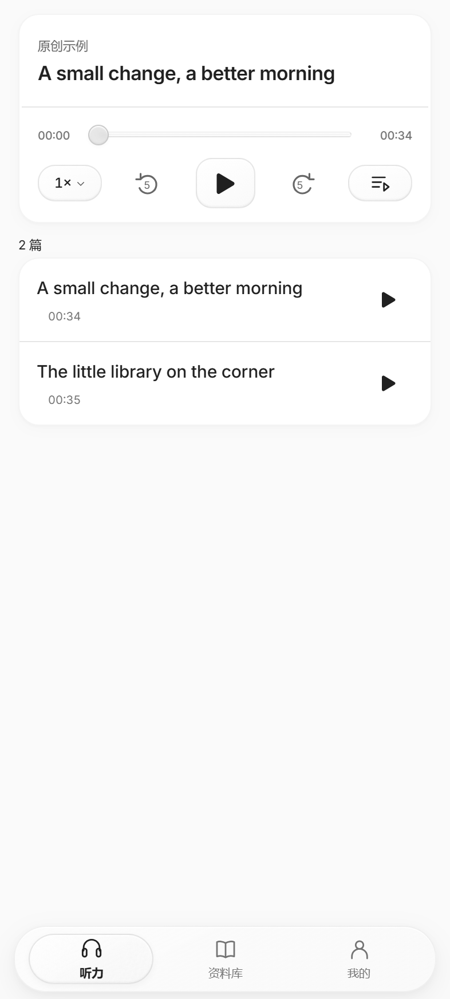 | 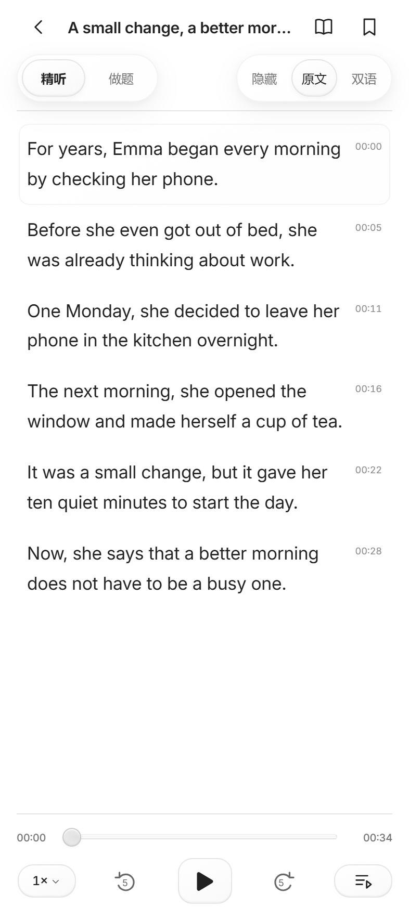 | 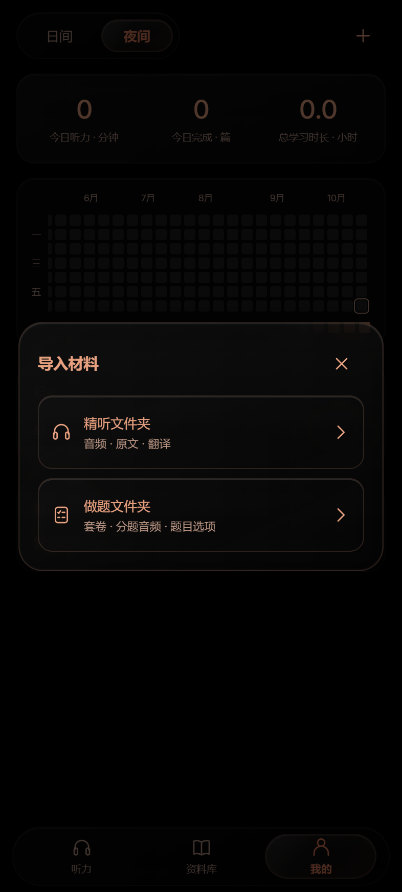 |

## 1.0.10 的首页播放器与导航透镜

底部导航使用连续移动的折射透镜，速度驱动横向拉伸、纵向压缩和回弹。快速反向选择会承接当前运动；重复点击当前项保持静止，减少动画时直接对齐。页面内容、焦点和导航状态同步更新，正文仍保留紧凑的音频底栏。

修复“我的”倍速胶囊切换主题时的亮上缘：背景、边框和内阴影同步切换，按压和展开反馈保留。[动效预览](docs/previews/navigation-lens.webm) · [实现与验证](docs/nav-lens.md)。

首页置顶卡片改为可拖动进度、前后跳转和调速的播放器；点击列表播放只更新置顶，完整文章列表保持原顺序。首页与正文共用音频和播放位置，支持暂停时先定位再播放。

本版通过 [Android 8 / 11 / 16 云端检查](https://github.com/AITopia-Shao/listenly-android/actions/runs/38981917125)，并在 Android 16／WebView 133 中用真实触控和原生截图确认非线性运动、中途反向与实际折射。连续六次日夜切换的 112 帧倍速材质同步更新，首页拖动、前后跳转和正文衔接也已验证。[1.0.10 安装包](https://github.com/AITopia-Shao/listenly-android/releases/tag/v1.0.10)与[完整验证范围](docs/nav-lens.md)可分别查看。realme GT7 本版尚未直接复测。

## 1.0.9 的交互与材质调整

同篇题目可分别展开、同时查看，选择答案只收起当前题。预览套卷或文章保留首页内容；点击右侧选择按钮，或文章实际开始播放后，才更新首页。日间／夜间切换与导入加号统一移到“我的”顶部。

播放按钮采用统一的圆润图形、紧凑触控区域与按压反馈；套卷选择增加勾选过渡和轻微高光，浮动导航、菜单与卡片统一边缘、层次和材质。英文使用随 APK 离线提供的 Inter 字体，中文使用系统字体；减少动画设置继续生效。材料、草稿、答案与学习记录保持原有数据格式。

本版通过 21 项主题／首页／资料库检查、24 组做题布局、18 组正文与安全区布局、86 项真实音频播放回归，以及 [Android 8 / 11 / 16 云端实装与跨套选择检查](https://github.com/AITopia-Shao/listenly-android/actions/runs/38863754801)。最终轻量版与公开演示版各通过 17 个原生播放场景和 8 项 Range 字节校验；历史失败和验证边界见 [界面与选择交互](docs/glass-ui.md)，安装包见 [1.0.9 发布页](https://github.com/AITopia-Shao/listenly-android/releases/tag/v1.0.9)。realme GT7 本版尚未直接复测。下图仅使用原创示例。

| 套卷选择 · 日间 | 套卷选择 · 夜间 | 夜间精听 |
| --- | --- | --- |
| 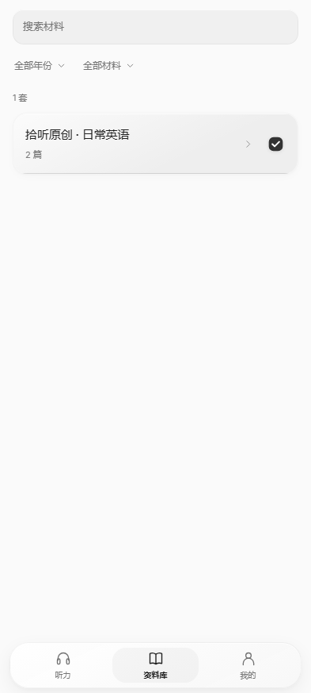 | 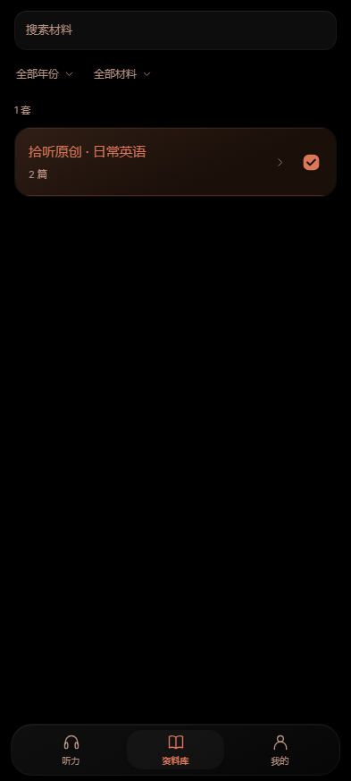 | 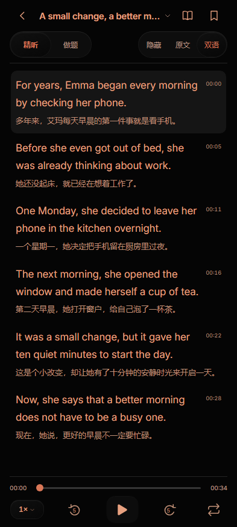 |

## 1.0.8 的整篇下拉答题

做题页移除书面题干，仅显示题号与选项。同篇所有题目集中在一个页面，点击题目行下拉展开选项，选择后收起并回显完整内容，不自动跳题。选齐后统一“提交本篇”，再展开查看正误与解析，或查看整篇成绩；既有答案、草稿和音频对齐继续保留。

本版通过 24 组新做题布局、17 项使用体验、86 项真实音频回归，以及 [Android 8 / 11 / 16 云端检查](https://github.com/AITopia-Shao/listenly-android/actions/runs/38749668307)。交互规则及验证范围见 [整篇下拉答题](docs/compact-quiz.md)，安装包见 [1.0.8 发布页](https://github.com/AITopia-Shao/listenly-android/releases/tag/v1.0.8)。

| 下拉选项 | 整篇待提交 | 夜间做题 |
| --- | --- | --- |
| 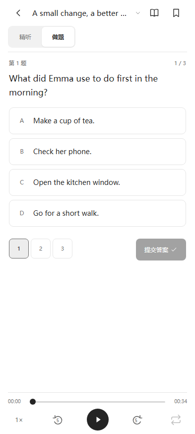 | 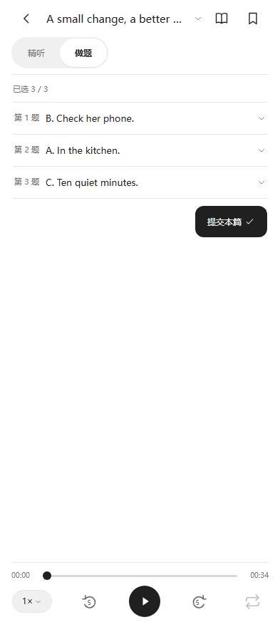 | 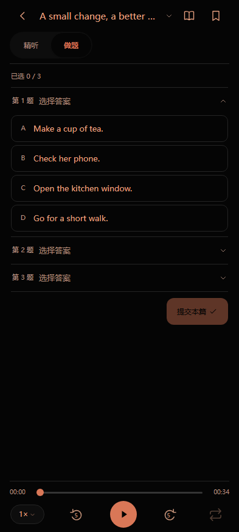 |

## 1.0.7 的套卷目录与完成统计

资料库改为套卷／文章二级目录，选择套卷后首页陈列该套文章；点击首页其他文章的播放按钮立即更新置顶。材料标题去掉末尾题号范围，年份和材料筛选采用无外部焦点框的文字菜单，日历右侧描边完整显示。

今日完成按整篇统计，全部题目提交才计数；最近练习只显示做完整篇的文章并去掉分钟后缀，个人页重复导入入口移除。听力分钟在完整覆盖文章后按实际播放日期入账，跳到结尾不计，原累计学习时长保留。历史迁移及验证口径见 [套卷与整篇完成验收](docs/papers-and-completion.md)。

[1.0.7 安装包](https://github.com/AITopia-Shao/listenly-android/releases/tag/v1.0.7) 已发布，[Android 8 / 11 / 16 与浏览器回归](https://github.com/AITopia-Shao/listenly-android/actions/runs/38567587075) 首次运行全部通过。

## 1.0.6 的交互打磨

应用图标改为黑底白色波形，夜间页面与原生背景统一调黑；日历移除冗余标题与“少／多”文字。正文显示控件顺序改为隐藏／原文／双语，并保留默认隐藏与阅读位置。

播放器与设置页采用统一倍速胶囊，可直接选四档并查看当前勾选。打开或取消菜单不改速度，播放中选速立即生效且保留音频与正文；安卓返回键只收起菜单。胶囊滑块、细边框、轻阴影与短促反馈进一步统一，播放点击区域和紧凑播放器高度保持稳定。实现与动效依据见 [界面打磨验收](docs/ui-polish.md)。

[1.0.6 安装包](https://github.com/AITopia-Shao/listenly-android/releases/tag/v1.0.6) 已发布，[Android 8 / 11 / 16 与浏览器回归](https://github.com/AITopia-Shao/listenly-android/actions/runs/38559169055) 首次运行全部通过。

## 1.0.5 的外观与学习记录

日间改为黑白灰，夜间使用黑底橙字，首页顶部提供外观切换；训练模式只在正文页显示。首页播放按钮直接播音频，标题进入正文并默认精听、隐藏原文。收藏只切换书签空心／实心，取消后不留下背景或提示框。

“我的”改为今日听力分钟、今日完成题次和累计学习小时，新增过去一年的做题活跃日历：日间绿色、夜间橙色，重做题目也累计活跃度。旧记录迁移与统计口径见 [外观及按日统计验收](docs/themes-and-activity.md)。

按压反馈保持点击区域固定，播放图标由实际媒体状态驱动；主题切换保留页面和音频，模式滑块从当前位置过渡，快速反向操作跟随最新选择，并尊重系统减少动画设置。

| 夜间首页 | 日间活跃度 | 夜间活跃度 |
| --- | --- | --- |
| 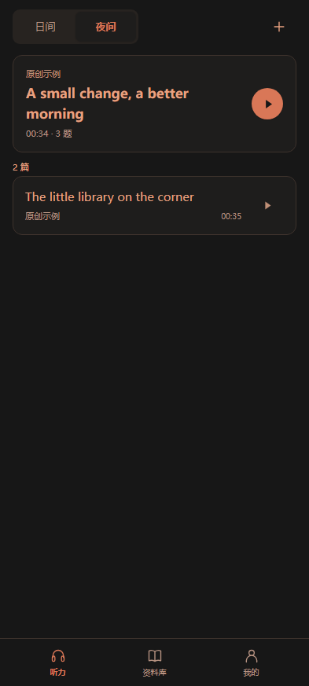 | 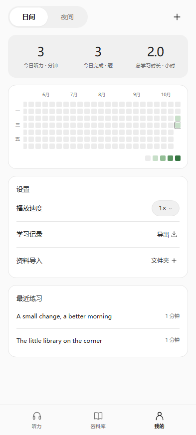 | 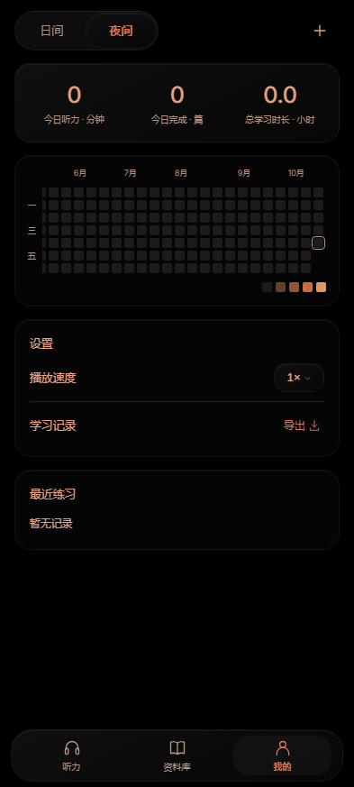 |

截图使用原创示例；活跃度截图含一次性演示记录，安装包不预填学习统计。[1.0.5 安装包](https://github.com/AITopia-Shao/listenly-android/releases/tag/v1.0.5) 与 [本次兼容性回归](https://github.com/AITopia-Shao/listenly-android/actions/runs/38553590758) 可分别下载和查看。

## 1.0.4 的播放修复

修复安卓 WebView 读取非零音频范围时二次跳过数据的问题，避免重开文章、切换材料或拖动进度后的解码失败；播放器出错后重新加载并保留位置，正常取消不再误报文件损坏，听完的文章重开从头播放。保留 1.0.3 的紧凑阅读布局。根因、旧包复现和验证范围见 [重复播放验收](docs/audio-replay.md)。

[1.0.4 安装包](https://github.com/AITopia-Shao/listenly-android/releases/tag/v1.0.4) 已发布，[本次 Android 8 / 11 / 16 实装、三轮重复播放与浏览器回归](https://github.com/AITopia-Shao/listenly-android/actions/runs/38519217979) 全部通过。

## 1.0.3 的界面调整

删除顶部品牌图块、宣传语、重复页面标题与常驻说明。首页和资料库直接展示材料、筛选与导入；精听和做题页使用完整屏高，底部音频条替换「听力 / 资料库 / 我的」导航，将空间留给正文或题目。

播放速度、前后跳 5 秒、播放 / 暂停、单句循环及进度拖动保留。顶部可返回、打开文章目录、进入资料库和收藏；长文章与长题目在正文区域滚动，不被播放器遮挡。同一文章的双语 / 原文切换保持句子阅读位置，同一题选择或提交答案保持滚动位置。

在 393 × 873 像素的浏览器窗口中，可阅读滚动区域从 273px 增至 684px，占窗口高度由 31.3% 增至 78.4%；播放器由 159px 缩为 84px，并移除原来的 70px 导航。该比例衡量可阅读区域的高度，不代表实际文字覆盖面积。带模拟安全区的测量与检查范围见 [紧凑阅读界面验收](docs/compact-reader.md)。

[1.0.3 安装包](https://github.com/AITopia-Shao/listenly-android/releases/tag/v1.0.3) 已发布，[本次 Android 8 / 11 / 16 与浏览器回归](https://github.com/AITopia-Shao/listenly-android/actions/runs/38491462110) 全部通过。

## 安装与材料

支持 **Android 8.0 及以上**，需要可用的系统 WebView。公开安装包内置原创英语示例，可离线体验全部训练流程，再从 `＋` 导入自己的材料。应用无需服务器、登录或 API 密钥，Android 包没有联网权限。

本仓库和公开 APK 提供应用代码、原创示例及测试夹具。历史六级试题、译文和录音没有明确的再发布许可，未随开源发布；项目的 MIT 许可证不授予这些第三方材料的权利。可导入自己制作或已获授权的文件夹。已有本地材料整理记录不代表公开版本内置完整真题库。

学习记录和导入文件保存在设备本地。自建 APK 的签名若与已安装版本不同，Android 会拒绝覆盖安装；继续使用原签名才能保留数据完成更新。公开 Release 附有 SHA-256 校验文件。

## 训练功能

- **精听**：隐藏 / 原文 / 双语三种显示；进度拖动、前后跳 5 秒、1–2 五档直接倍速循环；有可信时间戳的材料支持逐句定位。首页与正文支持顺序播放、单篇循环和随机播放。
- **做题**：同篇题目下拉选择、统一提交、正误与解析、整篇成绩及精听复盘。听力题干不在做题页显示；没有标准答案的题目保留作答，但不计入正确率。
- **成对导入**：精听文件夹保存音频、原文和译文；做题文件夹保存套卷、分题音频、题目与选项。同一套卷与文章使用相同的 `paper.id` / `article.id`，稳定的题目 `id` 保留既有答案。
- **模式对齐**：相同录音共用进度；独立切片按时间边界映射；非连续拼接音频通过 `audioTimeline` 映射回完整文章。缺少时间信息时分别保存进度，不推测对应关系。

## 开发与预览

前端是 HTML / CSS / JavaScript，Android 宿主使用 Java 和系统 WebView。构建时将前端转换为面向 Chromium 58 的经典脚本，补齐所用标准库方法，兼容旧版网页组件。

需要 Node.js 22、Python 3.10 或以上。克隆后生成独立的原创示例资产，不会读取本机真题库：

```bash
git clone https://github.com/AITopia-Shao/listenly-android.git
cd listenly-android
npm ci
npm run prepare:demo
npm run start:demo
```

打开 `http://127.0.0.1:4173`。Windows PowerShell 若无法运行 `npm.ps1`，可使用 `npm.cmd`。预览和安装包共用应用代码；浏览器导入的文件保存在 IndexedDB。

## 构建 Android APK

已验证的构建链使用 **JDK 21、Android SDK Platform 36、Build Tools 36.0.0**，直接调用官方 AAPT2、javac、D8、zipalign 和 apksigner。应用最低 API 为 26，目标 API 为 37；直接构建使用 SDK 36 的编译桩。源码未使用依赖更高版本编译桩的 API。

Windows 安装上述 SDK / JDK 并完成 `npm ci` 后，可构建公开示例版本：

```powershell
.\tools\build-apk.ps1 -Demo -SdkPath '你的 Android SDK 目录' -JdkPath '你的 JDK 21 目录'
```

`-Demo` 只打包原创示例，生成兼容前端后在 `.build/demo/main` 暂存资产，不将本机真实题库带入 APK。开发签名密钥留在本机并被 Git 忽略。发布自己的版本时应使用自己的签名与包名。

Linux 或 Windows 也可复现云端兼容性测试包：

```bash
npm ci
npm run build:web
python tools/prepare-ci-assets.py
python tools/build-apk-ci.py --sdk "$ANDROID_HOME" --java-home "$JAVA_HOME"
```

生成 `dist/listenly-ci-fixture.apk`。它只包含标注为测试夹具的合成测试音，使用临时签名，用于模拟器检查。示例版本包含英语朗读，可用于学习体验。云端流程见 [Android CI 说明](docs/android-ci.md)。

跨平台构建原创英语演示测试包：执行 `npm run prepare:demo` 后，运行 `python tools/build-apk-ci.py --demo --sdk "$ANDROID_HOME" --java-home "$JAVA_HOME"`，生成 `dist/listenly-demo-test.apk`。它也使用临时签名；直接安装体验请下载 Release 中的 APK。

### Android Studio / Gradle

仓库也提供标准 Android 工程，配置为 AGP 9.4.0、Gradle 9.6.0、`compileSdk/targetSdk 37`。先执行 `npm ci`，安装 Android SDK Platform 37，使用 JDK 21 后，在 Android Studio 打开根目录；或执行：

```bash
./gradlew assembleDebug
```

Windows 使用 `.\gradlew.bat assembleDebug`。Gradle 的 `preBuild` 自动构建兼容前端并准备独立示例资产，调试包位于 `app/build/outputs/apk/debug/`。Wrapper 9.6.0 已验证可运行；当前完成 APK 验收的是上面的直接 SDK 构建和云端 CI，完整 Gradle APK 构建尚未验证。

## 验证与兼容性

```bash
npm test
npm run test:demo
npm run test:ui
npm run test:replay
npm run test:experience
python tools/test-range-stream.py --java-home "$JAVA_HOME"
```

单元检查覆盖两种模式材料合并、ID 冲突、文件路径限制、字幕解析，以及切片与非连续时间线映射。GitHub Actions 在 Pixel 7 比例的 Android 8 / 11 / 16 模拟器上实际安装、启动、触摸播放、切换模式、作答并重新加载页面，保存日志、截图和结果文件。

浏览器检查前执行 `npm run prepare:demo`；Linux 安装测试浏览器使用 `npx playwright install --with-deps chromium`，Windows 默认使用已安装的 Edge。检查播放、模式对齐、评分、文件夹导入、重启恢复及 360 / 393 / 430 / 1280 像素宽度。Actions 同时构建包含原创英语朗读的演示测试包。

1.0.2 修复了启动时在创建 DecorView 前读取 WindowInsetsController 的空指针错误；WebView 不可用或渲染进程退出时显示原生诊断页，可复制信息和重试，不清除材料及记录。

下面的系统环境表和 Actions 链接记录 **1.0.2 的历史兼容性验收**。1.0.3 的界面回归与测试范围另见 [紧凑阅读界面验收](docs/compact-reader.md)。

| 已验证环境 | 结果 |
| --- | --- |
| GitHub Android 8 / API 26，WebView Chromium 69 | 启动、播放、模式对齐、答题、重载恢复通过 |
| GitHub Android 11 / API 30，WebView Chromium 83 | 同上 |
| GitHub Android 16 / API 36，WebView Chromium 133 | 同上 |
| 本地 Android 16 | 旧轻量 APK 复现启动崩溃；1.0.2 更新包播放、交互和渲染进程故障恢复通过 |

三版本回归证据：[成功的 Actions 运行](https://github.com/AITopia-Shao/listenly-android/actions/runs/38424901772)。**realme GT7 / realme UI 7.0 尚未直接测试**；模拟器结果只证明所列环境上的行为。详细范围与故障记录见 [Android 启动故障与兼容性验证](docs/android-runtime-findings.md)。

发布标签 `v1.0.2` 对应源码的原创示例构建与三系统回归已[全部通过](https://github.com/AITopia-Shao/listenly-android/actions/runs/38431767735)。公开 Release APK 的安装、触摸播放和保留答案检查见 [开源发布验收](docs/open-source-release.md)。

## 参与开发与许可

原始应用代码和文档使用 [MIT](LICENSE)，[原创英语示例](examples/demo/README.md) 使用 CC0-1.0。运行时 polyfill、构建和测试依赖保留各自许可证，见 [第三方声明](THIRD_PARTY_NOTICES.md)。提交方式见 [贡献说明](CONTRIBUTING.md)。不要提交个人学习记录、签名私钥或未经授权的真题文件。
