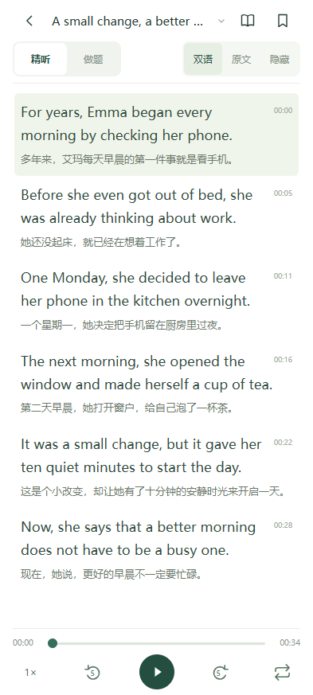

# 1.0.3 紧凑阅读界面验收

本次调整解决顶部说明、卡片空白和独立导航挤占正文的问题。删除「每一句，都听懂」「放慢一点，让英语慢慢清晰」等宣传文字、顶部品牌图块、重复页面标题和训练过程中的常驻解释。资料库直接提供材料筛选和列表；导入格式说明折叠在导入对话框内，需要时再展开。

## 阅读与播放

精听和做题页采用完整屏高的纵向布局：顶部文章操作、紧凑模式切换、可滚动正文、底部音频条。练习页的音频条替换原「听力 / 资料库 / 我的」导航；返回其他页面后恢复主导航。文章标题打开本套文章目录，顶部仍可返回、进入资料库和收藏。

播放器保留进度、时间、0.75–1.5 倍速、前后跳 5 秒、播放 / 暂停和有时间戳材料的单句循环。五个操作按钮的触控区域均为 44 × 44px；进度输入的命中区域高 24px，实际轨道高 3px。底部系统安全区只预留一次，不叠加导航空间。

文章正文和题目在独立阅读容器内滚动。英文正文使用至少 17px 字号，译文使用至少 13px，腾出的空间用于内容显示。同一文章切换双语或原文时，按可见句子的编号与位置保持阅读锚点；隐藏原文再返回时保留此前位置。同一题选择和提交答案时保留滚动位置，切换文章、模式或题目时从顶部显示。



## 已完成的浏览器测量

测量使用真实 Microsoft Edge 的无界面模式，通过 Playwright 读取渲染后的元素边界。基线为本次修改前的原创英语示例界面，新版为同一示例。所有数值为 CSS 像素。

| 393 × 873 窗口中的区域 | 修改前 | 1.0.3 |
| --- | ---: | ---: |
| 可阅读滚动区域高度 | 273px | 684px |
| 可阅读区域 / 窗口高度 | 31.3% | 78.4% |
| 音频播放器高度 | 159px | 84px |
| 练习页主导航高度 | 70px | 0px |

「可阅读区域」指正文或题目滚动容器在屏幕中实际可见、且未被播放器遮挡的高度；不表示文字覆盖面积。短文章未填满容器时，剩余区域仍属于阅读空间。

另模拟顶部 36px、底部 34px 的安卓安全区。在同一 393 × 873 窗口中，可阅读高度为 614px；扣除两端安全区后，可用高度为 803px，阅读区域占其 76.5%。播放器总高度为 118px，其中 34px 为底部安全区。该模拟验证布局计算，不能替代具体手机的系统栏测量。

检查覆盖 360 × 800、393 × 873 和 430 × 932 三种窗口，各自检查原文、双语和做题模式，并分别测试无安全区及 36 / 34px 安全区，共 18 种组合。结果均无横向溢出、仅有一个播放器、练习页无主导航；可阅读区域占扣除安全区后屏高的 74.1%–79.7%，全部高于 60%。文章末句能够滚动到播放器上方。

交互回归另外使用原创长文章和长选项，检查双语切换的句子锚点、隐藏原文往返、选择及提交答案后的滚动位置、新题从顶部开始、文章目录及导入对话框的访问。既有播放、模式对齐、评分、材料合并、文件夹导入和重新加载后的学习记录恢复检查继续执行。

可在 Windows 的 Edge 环境复现：

```powershell
npm.cmd ci
npm.cmd run prepare:demo
npm.cmd run test:ui
```

其他环境按 [README 中的测试浏览器说明](../README.md#验证与兼容性) 安装 Chromium 后运行相同脚本。布局检查实现见 [reader-layout.test.mjs](../tests/reader-layout.test.mjs)，交互入口见 [ui.test.mjs](../tests/ui.test.mjs)。运行生成的 `dist/reader-layout-results.json` 保存 18 组几何数据，`dist/reader-393-*-phone.png` 保存对应截图；这些临时产物不提交到源码仓库。修改前测量保存于本机 `dist/reader-layout-baseline.json`。

## 安装包与系统验证范围

本地 1.0.3 轻量升级包保留原轻量版的六级材料，并使用既有签名，供已安装版本覆盖更新。公开 1.0.3 演示包只内置原创英语示例；六级试题和录音没有明确再发布许可，继续保留在本地。两个版本使用同一套界面与播放器代码。

最终原创示例 APK 已在本地 Android 16 / Chromium 133 完成真实安装、冷启动和屏幕触摸检查，并核对已安装 `base.apk` 与交付包的 SHA-256 相同。412 × 915 的视窗中，正文可读区域由旧版约 243.05px 增至 654.52px（约 2.69 倍）；播放器主体为 83.76px，另预留 48px 系统安全区，练习页主导航数量为 0。

原生触摸播放从 0 增长至 0.1977 秒，暂停、前进与后退 5 秒有效；两种模式保留 10 秒位置，实际触摸作答和提交正确。覆盖安装后旧题答案及时间戳保留，新增答案在页面重载后保留，应用进程稳定。原始证据位于本机 `.build/runtime-results/compact-ui-api36-1.0.3/`。

本次云端 Android 8 / 11 / 16 回归运行后补入对应结果；此前的 [1.0.2 历史验收](android-runtime-findings.md) 仍单独保留。

realme GT7 / realme UI 7.0 的用户反馈是本次调整的依据；当前没有完成 1.0.3 在该真机上的直接测试。
