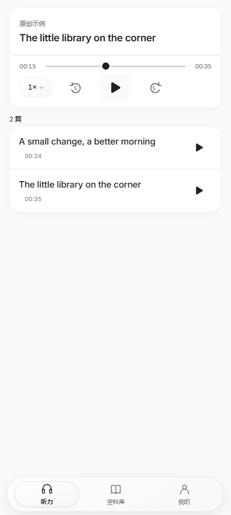

# 首页播放器、导航透镜与日夜切换

1.0.10 保留首页完整文章列表，置顶卡片增加与正文共用的进度和播放控制；底部导航使用持续移动的折射透镜，并修复“我的”播放速度胶囊切换主题时上沿短暂闪亮。

[实际界面动效视频](previews/navigation-lens.webm) · [逐帧预览](screenshots/navigation-filmstrip.png)

## 运动与操作

导航栏、按钮和透镜保持同一组 DOM 节点。点击目的地后，正文、`aria-current` 和焦点立即对应目的地，透镜从当前位置移动过去。运动由带阻尼的弹簧积分驱动，速度越快，横向拉伸和纵向压缩越明显。快速切到另一栏时沿用当下的位置、速度和形变；重复点击当前栏不会重播动画。

透镜不接收触摸，三个目的地保留至少 44 像素的点击范围。进入听力正文时导航让位给音频控制条；返回首页时直接对齐正确位置。横竖屏或宽度改变会重新测量。系统要求减少动画时立即对齐，不运行弹性尾部动画。

## 折射材质

透镜使用由圆角形状法线生成的二维位移图：中央保持平整，边缘逐渐弯折，R／G 通道分别承载横纵偏移。支持 SVG 背景滤镜的浏览器／WebView 会实际重采样透镜下方的背景，外层叠加克制的表面反光。旧环境保留连续运动与清晰的材质底色。减少透明度或强制颜色模式使用实色表面。

这是一套面向 Android WebView 的原创实现。设计依据参考 [Apple Materials](https://developer.apple.com/design/human-interface-guidelines/materials) 与 [Adopting Liquid Glass](https://developer.apple.com/documentation/TechnologyOverviews/adopting-liquid-glass)，没有将 Apple 的专有实现、SF 字体或 SF Symbols 打包进应用。

## 倍速胶囊

旧实现让边框与内高光参与独立颜色过渡，主题背景已经切换时，旧的浅色边缘仍可能在几帧内残留。现将材质的底色、边框、内高光在主题切换时同步更新，只为按压保留形变过渡。菜单打开仍有明确选中状态，倍速值与音频实际速率保持一致。

## 首页播放器

首页列表始终按所选套卷的原始顺序保留全部文章。播放某一篇后，仅更新置顶卡片；原行及其播放按钮继续留在原处，焦点也保留在刚点击的按钮上。置顶卡片与原行共同控制同一段音频，播放、暂停状态同步。

置顶卡片集中显示当前时间、总时长、可拖动进度条、倍速、前后五秒和播放按钮。尚未播放时，也能先拖动或跳转到需要的位置，音频保持暂停；随后播放从该位置继续。点击卡片标题进入默认的隐藏原文精听页面，继续同一篇、同一进度。

首页采用完整文章的时间轴。做题模式中的分题音频按其时间映射还原到全文位置；临时预览另一篇不会覆盖置顶文章的进度。即使两篇材料引用同一个音频文件，各自的位置也独立保存。音频元数据尚未加载时，用户选定的位置先保存，离页、重载后继续应用；明确拖到末端会保留末端位置，自然播放结束后的重播仍从开头开始。

以下截图使用内置 CC0 原创示例，通过实际播放、暂停和拖动定位捕获，置顶的第二篇仍显示在完整列表中。截图没有导入测试题目或第三方材料。

| 日间首页 | 夜间首页 |
| --- | --- |
|  |  |

## 验证状态

当前最终应用源码为 [`43c191b`](https://github.com/AITopia-Shao/listenly-android/commit/43c191b1be0de3287eddc98e4fdcc1fb314a29e0)。三版 1.0.10 安装包已完成签名、资源与来源校验，包内兼容入口 SHA-256 均为 `babe51b883c30a4db1aac50dd308cc42138aca2047727225188b07a541891084`；个人资料包的六级 JSON、录音 CRC 和长度与 1.0.9 相同。公开演示包只含两篇 CC0 原创示例和五道题。

本地浏览器已通过 10 项首页播放器行为、6 组首页布局、10 项导航透镜／主题、21 项主题与选择交互、7 项整篇答题、24 组做题布局、18 组正文与安全区布局和 86 项真实音频回归。41 项源码检查及 4 项原创示例／CI 资产契约也通过；测试验证实际音频、渲染几何和可信输入。

导航浏览器测试记录 31 帧跨栏移动和 36 帧中途改向，检查中间位置、非线性速度、弹性形变、当前位置连续、重复点击静止、主题切换不移动透镜、屏幕尺寸变化及减少动画行为。三轮日夜切换共采集 114 帧倍速材质，底色、边框和阴影在同一主题下逐帧一致；实际按压、展开菜单与修改倍速的反馈仍保留。

最终轻量 APK（SHA-256 `768b8ea8428c1ba6e2f8ed9a3a03be2dc3e15a3d35ca926c527b67d23211868e`）另在 Android 16／WebView 133 完成 7 项原生触摸检查，记录 23 帧跨栏运动、27 帧反向运动和六次主题切换的 112 帧材质。覆盖安装前后及测试结束时，原有答案和原生／浏览器导入记录一致，进程保持存活。

折射检查在实际透镜下方放置测试条纹，保持透镜原有样式和几何，仅打开／关闭位移滤镜后截取同一区域。独立使用 Pillow／NumPy 从原始 Android 截屏复算：28,413 个像素中有 2,438 个达到差异阈值（8.58%，平均通道差 3.44）；自然样式与强制打开滤镜的两张原始截图逐字节一致。该比较确认当前 WebView 实际执行了折射，不能仅以 CSS 声明被接受判为通过。旧环境未保证具备同样的折射能力，连续运动和清晰底色仍可使用。

本地最终轻量版完成 52 次经检查的可信原生触摸：保留已有 27 条答案，其中包括原创文章先前提交的两题，本次补答剩余一题后整篇提交，三题均已提交且完成数只增加一篇，总答案记录变为 28 条。实际拖动录得 10 个可信 MOVE 和 11 个可信 input，独立由最后 MOVE 推算 72.019 秒，音频与滑块均为 72 秒；前后五秒、进入隐藏原文精听及返回首页的定位一致。本次仅有一题待答，多题部分提交拦截由浏览器回归覆盖。

最终轻量版与公开演示版各通过 17 个原生播放场景和 8 项 Range 原始字节／哈希检查，28 条旧答案与导入记录保持一致。演示版另验证三题同时展开后逐项收起，展开集合依次为 `[0,1,2]` → `[1,2]` → `[2]` → `[]`。这项本地演示回放使用单独审阅的测试驱动修正，运行时记录其规范化 SHA-256 为 `562a82e547b8040725f51ddeb62248a9def556d45cf74fc59281a183a62081e0`；应用源码、APK 字节和云端运行仍绑定 `43c191b`，驱动修正随发布文档另行同步。最后已恢复轻量版，设备实际安装包 SHA-256 与上述最终轻量文件相同，28 条答案保留，首页仅有一条暂停的进度控制。

[最终 GitHub 云端运行 38981917125](https://github.com/AITopia-Shao/listenly-android/actions/runs/38981917125) 的四项作业全部通过，原始日志和四份产物已下载并独立审计。Android 8／11／16 分别使用 WebView 69／83／133，各完成 41 次受检查的可信触摸、16 个回放场景、8 项 Range 字节检查与 74 项 Java 流契约检查；三平台拖动的实际 MOVE 换算误差分别为 0.032、0.017、0.003 秒，无系统 ANR 恢复操作。云端浏览器还通过首页播放器、透镜、主题／选择、整篇答题、布局与 62 项原创音频回归；Python 资产契约共 7 项。

早期运行中一次拖动测试错误地将 ADB 的抬手坐标当作滑块最后移动坐标；现直接记录真实 MOVE 坐标并独立换算到音频时间，误差须小于 0.3 秒。另一云端 Android 16 运行在安装应用之前遇到 Quickstep 桌面 ANR，已保留原始日志与截图；只允许等待经日志确认的启动前系统桌面故障，应用 ANR 或未知故障仍直接失败。旧演示回放驱动在先前已有三题展开时，错误地要求刚由测试主动收起的一题继续展开；修正后逐项检查准确的剩余展开集合，重新完整执行 17 个场景。所有早期失败单独保存并排除在通过数量之外，完整本地审计报告为 `dist/test-results-1.0.10.json`。

realme GT7／realme UI 7.0 本版尚未直接复测。
