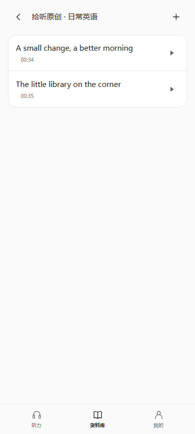
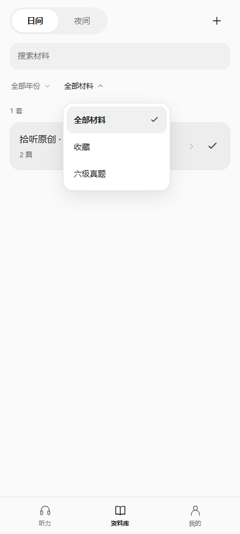

# 套卷目录与整篇完成统计（1.0.7）

资料库先按套卷显示，年份和材料类别采用无外部焦点矩形的文字菜单。点击套卷标题会选择该套并进入文章目录，右侧选择图标可直接选定套卷。日间选中套卷为灰色，夜间为橙色；选择保存在本地，首页仅陈列该套内的文章。目录返回按钮和安卓返回键回到套卷列表，筛选菜单打开时返回键只关闭菜单。

首页点击其他文章的播放按钮会立即将该文章更新为置顶材料，不必先进入正文；新置顶播放按钮可暂停该录音。材料列表、文章目录、正文标题和最近练习统一移除末尾的题号范围，例如 `Section A · 第 1 篇 · 1–4 题` 显示为 `Section A · 第 1 篇`。源文件、材料编号、实际题目编号和音频对齐不变。

日历网格内侧保留 3 px 空间，完整显示最右侧当日色块与描边；隐藏滚动条，全年横向滑动仍可用。“我的”移除重复的资料导入行，顶部加号保留。

## 统计口径

- 今日完成：以篇为单位，全部题目提交后才计一篇，不要求每题正确或进入成绩页。重复提交与重开不重复计数；完整重做一轮可再计一篇，部分重做不计。
- 最近练习：只列出完整完成过题目的文章，按最近一次整篇完成时间排序，移除分钟后缀。单纯播放和部分作答不新增或刷新该记录。
- 今日听力：完整文章的播放覆盖全部音频后，才将该轮实际听音频的秒数计入，累积并换算为整数分钟。拖到结尾、跳过未听片段和独立分题切片不视为完整播放；暂停、返回或重启后的未完成覆盖可继续累积。
- 跨午夜的听力：完整听完后按实际听音频的本地日期入账，不将昨日秒数全部归到今日。未完成时，这些秒数只保留在累计学习时长中。
- 总学习时长继续保留实际听力时间及不重叠的前台做题时间；日历颜色仍按当日提交的题次表示活跃程度。

旧答案、收藏、导入文件和累计学习时间保留。旧版当前答案能证明整篇完成且有有效提交时间时，迁移到最后一次提交日期；旧版已被覆盖的多次完整重做无法补回。旧听力计数不能证明完整播放，因此不推测完整听力分钟。统计字段使用同一存储键升级，材料与答案编号不改变。

## 验证

41 项源码检查通过，其中 30 项覆盖统计、迁移、重复提交、整篇重做、连续播放范围、跨午夜、重载及夏令时。浏览器 17 项交互检查覆盖二级目录、套卷选择与重载、首页即时置顶、干净标题、完成统计、实际 2 秒录音的自然结束与跳到结尾不计入；另外 18 组屏幕尺寸／安全区布局及 86 项实际真题音频回归通过。

[Android 8 / 11 / 16 云端实装与浏览器流程](https://github.com/AITopia-Shao/listenly-android/actions/runs/38567587075) 四项作业首次全部通过。各系统验证筛选／目录返回、套卷选择、统计界面、日历描边及原有交互，并分别完成 15 个播放场景与 8 项 Range 字节／哈希校验。单篇云端夹具不声称验证跨文章首页置顶；该项由双文章浏览器和本地安装包真实触摸验证。

最终轻量包与公开演示包另在本地 Android 16 / WebView 133 各通过 16 个触摸播放场景和 8 项 Range 校验，答案与导入清单保持一致。realme GT7 / realme UI 7.0 尚未直接复测本版。

| 套卷列表 | 套内文章 | 筛选菜单 |
| --- | --- | --- |
|  |  |  |

截图使用原创示例；统计截图中的演示记录不进入安装包。1.0.7 使用 versionCode 8 并沿用旧签名，资料 JSON、音频 CRC 与文件长度和 1.0.6 逐一一致。
