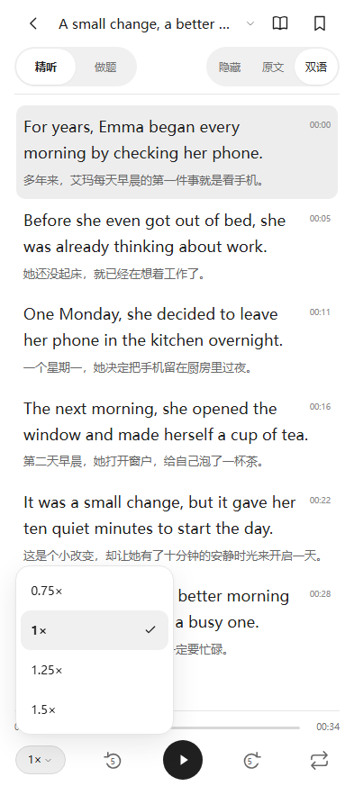
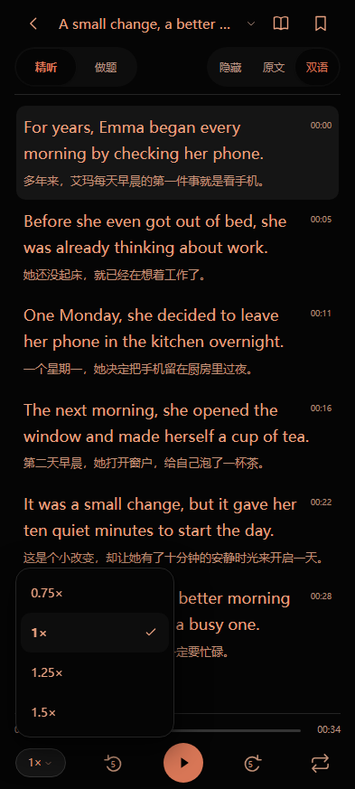

# 黑白标识、纯黑外观与倍速菜单（1.0.6）

桌面、圆形桌面入口与系统使用的应用图标统一为黑底白色波形，保留原矢量图案和兼容路径。最终 APK 编译后的图标填充色已经核对为 `#FF000000` 与 `#FFFFFFFF`，不再含浅绿色。

夜间页面和原生窗口底色为纯黑 `#000000`，正文表面为 `#050505`，控件底层为 `#0D0D0D`；边框、选中背景和反馈面板统一使用中性深灰。暖橙文字及日历橙色层级保留。日间继续使用黑白灰。

日历移除可见的“做题活跃度”“过去一年”和量表两端“少”“多”，保留月份、星期、每日色块与颜色量表；日期和题数仍提供给读屏和长按提示。正文显示选项从左至右为“隐藏、原文、双语”，默认隐藏及原有阅读位置保持逻辑不变。

## 速度与动效

正文播放器与设置页使用同一倍速胶囊。点击后就近展开四个选项：0.75×、1×、1.25×、1.5×，当前速度带勾选。打开菜单不更改速度；选择后立即应用、保存并收起，正文与音频节点保留，不调用音频重载。点外侧、Escape、安卓返回键取消，只关闭菜单；安卓返回键不同时退出正文。键盘方向键可移动选项焦点，Tab 返回正常焦点顺序。

菜单在触发器附近进行 160 ms 的小幅展开，选择即生效，无需等待动画。训练模式和原文显示滑块使用 200 ms 过渡，反向点击从当前可见位置收束到新选择。播放控件保持位置和点击范围，图标由实际媒体状态驱动；正文切换只轻微淡入。细边框、胶囊圆角、轻阴影和按压反馈使用统一尺度，播放器保持 84 px 紧凑高度。系统减少动画偏好会禁用过渡与伪元素动画。

设计参考 [Apple Motion](https://developer.apple.com/design/human-interface-guidelines/motion) 对简短、符合操作预期、可取消反馈的建议，以及 [Apple Menus](https://developer.apple.com/design/human-interface-guidelines/menus) 的菜单组织原则。实现仍使用项目的 Android／WebView 兼容组件。

| 日间速度菜单 | 夜间速度菜单 |
| --- | --- |
|  |  |

## 验证

同一最终前端入口 `ed67f9c0fca275321fd9afd274312b422c16e088526528bff1a37dca1b9d436a` 通过 29 项源码检查、14 项主题／首页／倍速／统计交互检查、18 组手机尺寸与安全区布局检查，以及真实 WAV、Blob、M4A 和独立分题切片的 86 项播放回归。

[GitHub Android 8 / 11 / 16 实装与浏览器流程](https://github.com/AITopia-Shao/listenly-android/actions/runs/38559169055) 四个作业首次运行全部通过。各 Android 版本都用实际触摸选择倍速，验证播放不中断、速度保存、返回键取消，以及纯黑背景、收藏与显示顺序；各版本另通过 15 个重复播放场景与 8 项音频范围字节／哈希校验。未放宽既有断言，也未恢复系统无响应弹窗。

最终本地轻量安装包另在 Android 16 / WebView 133 实装验证以上功能，并通过 16 个真题及句循环重复播放场景和 8 项 Range 校验。正文模式对齐、答案与导入清单保留。realme GT7 / realme UI 7.0 尚未直接复测本版。

1.0.6 使用 versionCode 7 并沿用旧签名。轻量版与完整版的资料 JSON、音频 CRC 和长度均与 1.0.5 一致；公开 APK 只包含两个原创英语示例与五道题。
